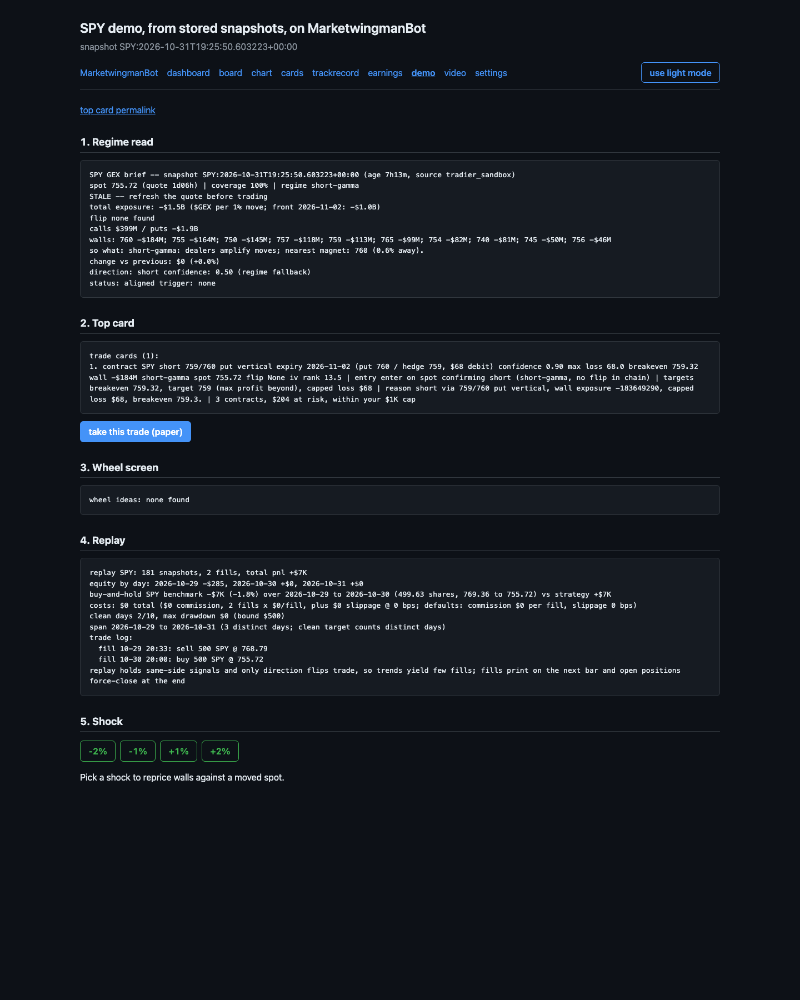
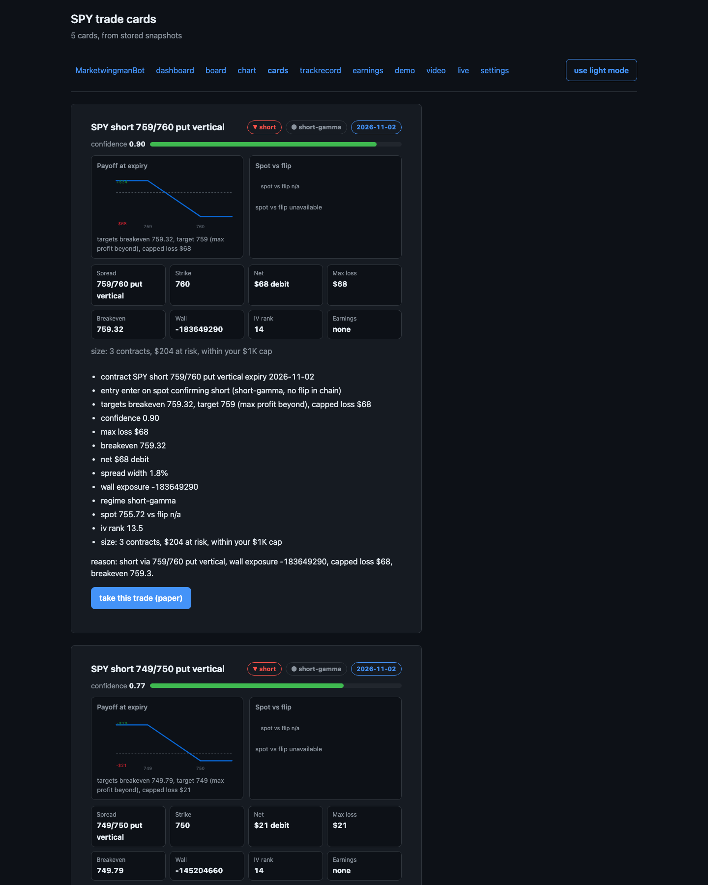
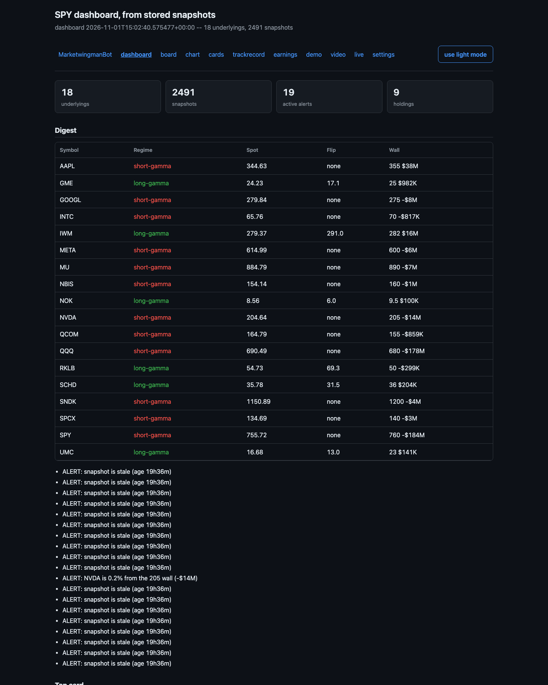
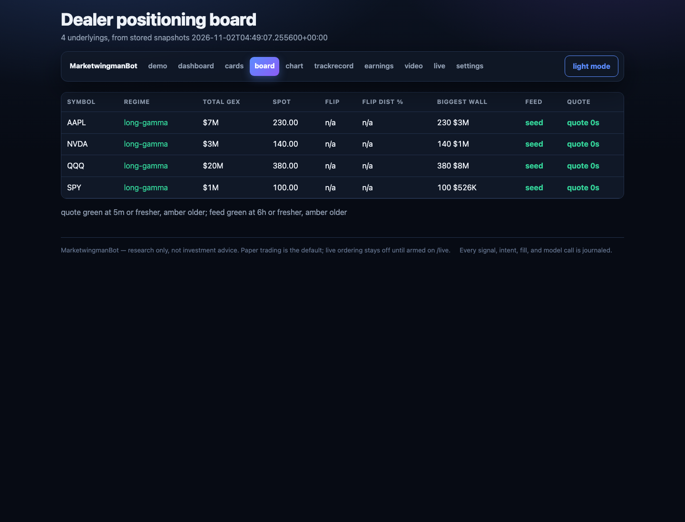
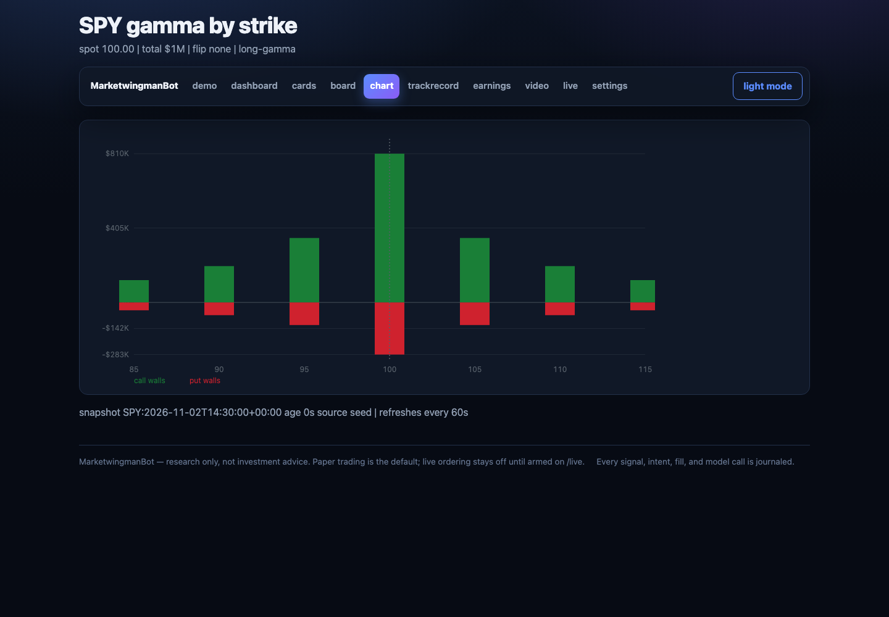
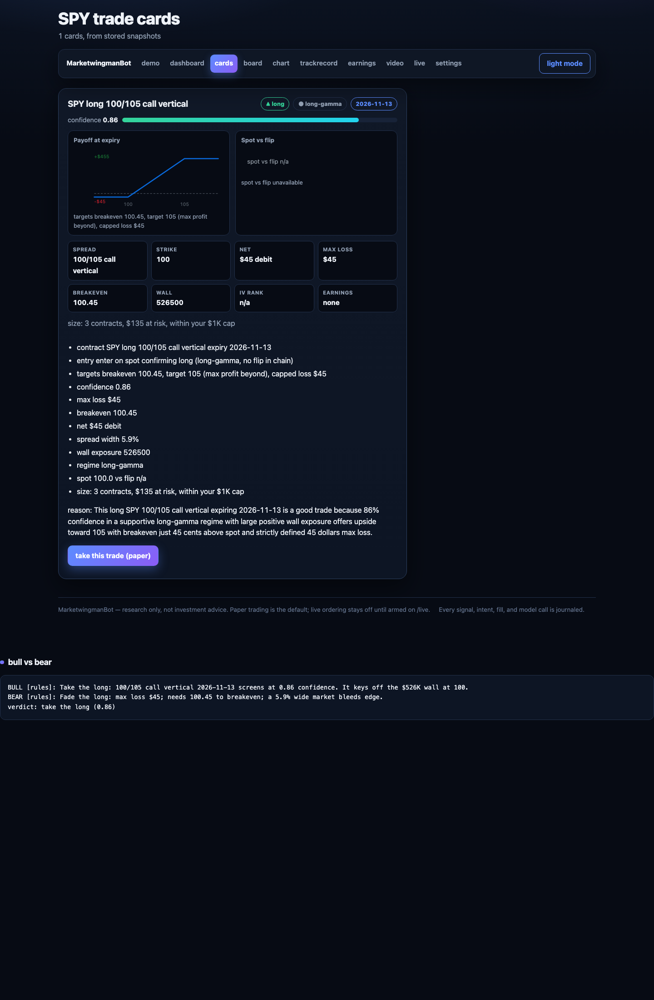

# TradingWingManBot

A research-first options trading system. It ingests free-tier market data, computes its own GEX/VEX/DEX/CHARM/VANNA exposure from stored snapshots, answers research questions in chat, and journals every signal, intent, and fill. Paper trading works out of the box. Live ordering stays off until you arm it on the `/live` page with a signed action, and only cards at or above your confidence threshold can reach the broker.

What you get: a one-screen demo with regime read, trade cards, replay, and shock test; a dashboard and positioning board across every stored underlying; gamma-by-strike charts; defined-risk trade ideas and premium screens; honest next-bar replay scored against buy-and-hold; a visual strategy builder that backtests your guardrails; data-backed feedback on a strategy you state in plain English; Discord and Telegram alerts. See the [app tour](#app-tour).

Run the suite with no keys and no network:

```bash
python -m venv .venv
.venv/bin/pip install pytest ruff mypy
.venv/bin/python -m pytest tests/ -q
```

Then serve the dashboard (it serves whatever is in `data/trading-bot`, so seed that directory first with the snippet under [interactive snippets](#interactive-snippets) or add keys to `.env`):

```bash
.venv/bin/python run_app.py
```

Open `localhost:8000/demo`. Without keys the suite and every offline flow run on canned fixtures. Copy `.env.example` to `.env` when you want live data.

The design pseudocode lives in [overview.md](overview.md). Diagrams live in [diagrams/](diagrams/) as Mermaid sources. AI agents start with [AGENTS.md](AGENTS.md).

Meta model integration is implemented: a Muse Spark analyst behind the research loop, voice input, brief cards, a Muse Wonder advisory review, and the M5 standout set (local Glimmer/Spark Open analyst, cost-aware tier router, chart and document readers, shock news, voice holdings and kill, journal coach, alert narration, portfolio commands, shareable cards).

## How it works

Data flows one way, and every step writes to the journal:

```
market APIs ──▶ feeds ──▶ store ──▶ exposure ──▶ research ──▶ risk ──▶ paper venue
                  │          │          │             │           │
                  └──────────┴──────────┴─────────────┴───────────┴──▶ journal
```

Meta Model API serves a Spark analyst behind research, plus voice input, card art, a Wonder advisory review, and the M5 tier-routed standout set (local analyst, coach, narration, portfolio commands, chart and document readers, shareable cards); every model call journals a ModelReceipt.

1. **Feeds** (`bot/feeds.py`) pull options chains and daily bars from six sources through a registry table keyed by source name. Each adapter normalizes vendor JSON into `ChainSnapshot` or `Bar` records stamped with source name and latency.
2. **Store** (`bot/store.py`) is an in-memory snapshot and bar store with bar dedupe, indexed latest-reads, per-underlying retention, and previous-snapshot lookup. `read_latest` serves the research loop.
3. **Exposure** (`bot/exposure.py`) computes GEX, VEX, DEX, CHARM, and VANNA from stored chains in one pass: signed Greek × open interest × multiplier per contract, summed per strike, plus the interpolated flip point where cumulative exposure crosses zero. With spot it reports $GEX per 1% move with a front-expiry split. No vendor GEX feed is required.
4. **Research** (`bot/research.py`) is the chat loop. It reads the latest snapshot, computes the profile, runs the analyst tool, derives display fields (status, trigger, entry band, checklist, coverage), and returns a compact text brief with snapshot age, top walls, and change versus the previous snapshot. Card requests return per-trade cards with a one-line reason each. VEX, DEX, CHARM, and VANNA requests get their own briefs. The analyst tool routes through the tier router when live_models=True (hosted Spark first, local Glimmer/Spark Open rescue on failure, deterministic rule last); otherwise the deterministic rule runs as the offline fallback (Phases M1, M5). Grounding appends a web-searched note to theses when grounding=True, and voice notes transcribe through bot/voice.py and route as chat queries (Phase M2). Brief cards append a card line when cards=True, and advisory_review gives a standalone Wonder pre-promotion read (Phase M3). Profile messages print a four-question risk questionnaire or save a one-shot OperatorProfile with suggested risk params. Idea requests return up to 15 ranked defined-risk verticals filtered by timeframe words and named stocks; naming a stock with no stored snapshot errors instead of falling back. Scheduled briefs append flip-cross, regime-flip, and stale-snapshot alerts.
5. **Risk** (`bot/risk.py`) sizes intents from account size × risk per trade (1% default) scaled by signal confidence, or by max loss per contract for options, and returns no intent for flat signals. `review_intent` runs inside both submit paths, so halt, kill, schema, size, day-target, and options-profile checks apply to every order with no separate review call; rejections raise `IntentRejectedError` on paper and block live. Closes skip the day-target veto so exits always proceed. Day PnL accumulates unrealized moves plus realized closes. A daily-loss breach halts the day.
6. **Autonomy** (`bot/autonomy.py`) gates promotion: clean paper days plus bounded drawdown plus passed halt drills yields `ready_for_checklist`. Live ordering ships disabled and needs an explicit signed action. The kill switch flattens auto-ordering and needs an operator reset.
7. **Trade cards** (`bot/tradecards.py`) builds one card per recommended trade from the same screener as ideas: the contract (spread, strikes, expiry, debit/credit) plus wall exposure plus regime plus spot versus flip, with the entry trigger, targets (breakeven plus max-profit strike), sizing against the operator cap, and a one-line reason written by the Meta analyst model (`bot/metareason.py`) or the deterministic offline fallback. Live reasons generate off the request path into a stats-keyed cache, so first paint serves the fallback and later fetches serve the model reason. Chat answers card queries with text cards; the HTTP server renders them at `/cards` and `/cards.json` as visual cards (badges, confidence meter, payoff-at-expiry diagram, spot-vs-flip gauge, facts grid) with response caching and ETags.
8. **Replay** (`bot/replay.py`) replays stored snapshots in time order with no lookahead, either as journaled totals or as a full signal-to-paper-fill backtest that generates its own `PaperEvidence`. Signals stage pending orders that fill at the next bar open, open positions mark every bar, day PnL and halt reset daily, and anything still open force-closes at the last bar. Each run carries a deterministic run id so reruns never double-journal fills, and steps report daily PnL plus cumulative total plus equity for `PaperEvidence`. The `run_replay` tool and the `replay` chat keyword run it over the stored bundle into a one-screen demo summary, replay fills journal under a `replay` venue that `paper_pnl` reports separately from live fills, and `/replay.csv` downloads steps, fills, or the SPY benchmark as CSV.
9. **Surfaces** (`bot/charts.py`, `bot/alerts.py`) render the gamma-by-strike chart at `/chart` and the regime board at `/board`, and push flip, regime, and wall-proximity alerts to Discord or Telegram from every session run, with optional one-line narration and noise filtering.

## Modules

| Module | Owns |
|---|---|
| `bot/shapes.py` | Frozen dataclasses: `Bar`, `OptionContract`, `ChainSnapshot`, `GexProfile`, `VexProfile`, `DexProfile`, `CharmProfile`, `VannaProfile`, `Signal`, `OrderIntent`, `OrderLeg`, `Fill`, `Position`, `RiskState`, `JournalEntry`, `OperatorConfig`, `RiskLimits`, `PaperEvidence`, `ModelReceipt`, `OperatorProfile`, `TradeIdea`, `PremiumCandidate`, `PortfolioView`, `Holding`, `PaperAccount` |
| `bot/feeds.py` | `FeedContext`, six adapters, `FEED_REGISTRY`, kind/fallback tables, `ingest_chain`, `ingest_bars`, `live_context`, `default_context`, journal-sourced `feed_health`, 10s timeout with env override, 60s GET cache |
| `bot/store.py` | `SnapshotStore`: snapshots plus bars plus saved profile plus holdings, latest/previous reads, underlying listing, dedupe, `prune`, `restore` |
| `bot/journal.py` | `Journal`: append-only timestamped event log, `prune` for long runs |
| `bot/persist.py` | `save_bundle`, `load_bundle`: JSON snapshots plus bars plus journal plus profile plus IV plus holdings plus dashboard settings (theme, underlying, refresh, live auto-send, live threshold), retention caps, `refresh_bundle` for live reload |
| `bot/schedule.py` | `run_scheduled_session`: multi-underlying ingest plus brief plus persist in one job; `refresh_store`: ingest-only timer refresh; per-symbol refresh runs concurrently, and `SCAN_BROAD=1` (or `SCAN_UNIVERSE`) widens the universe past the requested symbols |
| `bot/exposure.py` | `compute_gex` ($GEX per 1% move with spot, interpolated flip), `compute_vex`, `compute_dex`, `compute_charm`, `compute_vanna`, all from one `compute_exposures` pass |
| `bot/research.py` | `route_chat`, `handle_chat_query`, `scheduled_brief`, `live_brief`, trade cards, VEX/DEX/CHARM/VANNA briefs, change alerts, `journal_tail_text`, `paper_pnl_text`, profile questionnaire, trade ideas, `advisory_review` (facade over the four `research_*` libs below) |
| `bot/research_analyst.py` | Spark, local, grounded, and advisory analyst backends |
| `bot/research_formatters.py` | Brief and exposure formatting over engine profiles |
| `bot/research_paper.py` | Paper trade execution and PnL reporting over the persistent `PaperAccount` |
| `bot/research_ingest.py` | Feed ingest helpers and option IV recording |
| `bot/risk.py` | `build_intent` with confidence sizing, `even_legs`, `review_intent` with profile gating enforced inside both submits, `submit_paper`, `paper_fill_price`, `realized_pnl`, halt/kill transitions, `PaperAccount` maintenance |
| `bot/autonomy.py` | `check_promotion`, `enable_live`, `kill_switch`, `reset_autonomy`, `submit_live` |
| `bot/live_trade.py` | Confidence-gated live execution: threshold-checked intent per card, explicit `take_live_trade`, capped `maybe_auto_live` bulk send, process-memory live state, `/live` arm/kill helpers |
| `bot/strategy.py` | `parse_strategy`, `evaluate_strategy`: plain-English strategy to backtested feedback over stored snapshots and bars |
| `bot/builder.py` | Visual strategy builder: guardrail form plus matching-idea preview plus backtest at `/builder` |
| `bot/venue.py` | Tradier live venue: `occ_symbol`, equity, single-option, and combo orders, `LiveAck` |
| `bot/tradecards.py` | `TradeCard`, card builder over `rank_ideas`, text plus JSON plus HTML renderers, read-through card cache, async reason queue plus worker; auto-live hook fires only when the setting is on |
| `bot/replay.py` | `replay_week` (totals or next-bar-fill backtest with force-close and run ids, plus optional custom `signal_fn`), `paper_evidence_from_journal`, pure `replay_report` plus journaling `replay_response`, CSV `replay_export` |
| `bot/charts.py` | Gamma-by-strike SVG chart page plus multi-ticker regime board, both auto-refreshing; the chart scales each side to its own peak with half-peak gridlines |
| `bot/alerts.py` | Wall-proximity plus wall-growth plus flip/regime alerts with Discord/Telegram push and journal dedup, one-line narration, local noise judge |
| `bot/diff.py` | Latest-two-snapshot diff: regime, flip, wall growth, totals, top movers |
| `bot/shock.py` | Spot-shock repricing: broken walls, flip cross, Black-Scholes position repricing at shocked spot and IV, intrinsic card P&L table |
| `bot/holdings.py` | Operator book parsing plus position-aware risk vs flip, spot, and walls, spoken-holdings parser |
| `bot/debate.py` | Bull-bear card debate: analyst vs reviewer with grounded rules fallback |
| `bot/demo.py` | Snapshot-pinned card lookup shared by permalinks and debate |
| `bot/dashboard.py` | One-screen digest: `dashboard_text` plus `dashboard_html` over stored underlyings |
| `bot/slash.py` | Slash registry: `SLASH_COMMANDS` mapping chat commands onto MCP tools, help plus info text |
| `bot/models.py` | `MODEL_REGISTRY`, Spark tool loop, `ModelReceipt`, day-budget gate with ledger reservations |
| `bot/localmodels.py` | Local Glimmer/Spark Open backend: one persistent `llama-server` per weights file, prompts in POST body, zero-cost receipts |
| `bot/tiers.py` | Cost-aware tier router: draft/deep/premium task classes over local/Spark/Wonder plus fallback |
| `bot/voice.py` | Ogg-to-WAV conversion plus 16kHz WAV transcription into chat commands, `voice_transcript` journaling, spoken holdings, two-step voice kill |
| `bot/cards.py` | Regime card art with engine numbers, `brief_card` journaling, shareable signal art with cache, milestone art |
| `bot/chartread.py` | Spark multimodal chart screenshot reader grounded in engine walls and flip |
| `bot/docread.py` | SAM 3.1 region segmentation plus Spark document reading with region hints |
| `bot/news.py` | Shock repricing plus a cited Responses web-search driver |
| `bot/coach.py` | Wonder journal coach with deterministic rules fallback |
| `bot/commands.py` | Natural-language paper portfolio commands: closes, rolls, two-step flatten, Spark tool assist |
| `bot/profile.py` | Risk questionnaire table, answer parsing, `OperatorProfile`, suggested params |
| `bot/ideas.py` | Timeframe and symbol parsing, shared `resolve_direction`, shared `diversify` helper, ranked top-15 `TradeIdea` screener (round-robin fill, 5/symbol, 5/expiry, 2/strike-cluster, 7/direction caps, 1-day expiry floor, `SCAN_MAX_IDEAS` override) with defined-risk verticals; `"scan all"` screens every stored underlying; live quotes earn delta, spread, tenor, and IV-rank quality adjustments while quoteless fixtures score as before; naming a ticker with no snapshot errors instead of falling back |
| `bot/wheel.py` | Cash-secured-put plus covered-call premium screener: staged `screen_premium` over stored snapshots, Friday-preferring expiry picker, earnings skip, IV rank gate, diversified top-10 `PremiumCandidate` ranking, `wheel_response` chat reply |
| `bot/ivrank.py` | IV rank and IV percentile math plus store-backed per-symbol history helpers; vendor IV auto-records on ingest, Alpaca options snapshots backfill chains without Greeks with Yahoo as fallback, `backfill_iv_history` seeds history from stored snapshots |
| `bot/config.py` | Single dotenv plus environment reader, bearer token, profile-to-limits `operator_config` |
| `bot/metareason.py` | Meta reason-model client: `generate_reason`, backend selection |
| `bot/baseten.py` | Dormant Baseten client (`predict_url`, Inference API slugs) for later |
| `bot/muse.py` | Muse chat transport: `parse_chat_payload`, `handle_chat`, `TOOL_REGISTRY`, `dispatch_tool`, `openapi_spec`, `route_http`, `create_server`, `serve` with timer refresh, open-server warning, drill `Harness` (facade over the four `muse_*` libs below) |
| `bot/muse_tools.py` | MCP tool handlers plus `TOOL_REGISTRY` |
| `bot/muse_chat.py` | Chat payload parsing, LLM routing, `dispatch_tool` |
| `bot/muse_session.py` | Session trigger path, schedule parsing, `SessionController` |
| `bot/muse_http.py` | HTTP primitives, `openapi_spec`, `route_http`, response cache with ETags |
| `bot/video.py` | HyperFrames video brief: frozen scene model, timeline-free composition HTML, project writer, npx render shell, chat plus tool plus session wiring |
| `bot/ledger.py` | Reservation ledger: atomic quota claims plus lock-serialized budget holds with TTL expiry and idempotent settle |

## Feeds

| Feed | Kind | Credential | Role |
|---|---|---|---|
| `tradier_sandbox` | chain | `TRADIER_ACCESS_TOKEN` | Primary chain. Sandbox is delayed ~15 min without Greeks; production has Greeks |
| `marketdata_eod` | chain | `MARKETDATA_API_KEY` | EOD chain seed and fallback. 100 free credits/day |
| `alpaca` | bars | `APCA_API_KEY_ID` + `APCA_API_SECRET_KEY` | Primary daily bars (IEX rail) |
| `finnhub` | bars | `FINNHUB_API_KEY` | Live quote bar plus earnings calendar; stored every tick alongside the daily winner so marks track spot |
| `yfinance` | bars | none | Unkeyed backup |
| `alpha_vantage` | bars | `ALPHA_VANTAGE_API_KEY` | Last-resort daily bars with ~100-day depth; at most one call per symbol per day (journal-guarded) |

Fallback order is fixed tables: chains try Tradier then Market Data; bars try Alpaca, Finnhub, Yahoo, then Alpha Vantage. Quota-capped feeds skip when the journal shows a fetch for that symbol today, so Alpha Vantage costs at most one call per symbol per day no matter how often sessions tick. `bot/ledger.py` additionally reserves quota before each feed call through atomic claim files, so concurrent sessions never double-spend a daily cap. Ingest latency and per-source lineage journal under each fetch, and `/feeds` plus the `feeds` key on `/health` turn that lineage into a health view: last success, latency, and quota use per source. Seed one symbol by hand with `ingest_bars("alpha_vantage", store, journal)`. An empty bar result counts as feed failure and falls through to the next source. `live_brief` journals each failure with the error class name only, raises `FeedUnavailableError` when every chain feed fails, and treats bars as best effort (without a bar or a flip, direction falls back to the regime sign and the brief says so).

Without arguments, `ingest_chain`/`ingest_bars` use canned vendor-shaped fixtures, so the whole suite and every offline flow run with no keys and no network.

## Configuration

Copy these into a `.env` file in the repo root (never commit it):

```
GLIMMER_GGUF_PATH=<path>   # optional; local Glimmer weights for the offline tier
SPARK_OPEN_GGUF_PATH=<path>   # optional; local Spark Open weights (used when Glimmer is unset)
LLAMA_SERVER_BIN=llama-server   # optional; local server binary on PATH
TRADIER_ACCESS_TOKEN=<token>
TRADIER_ACCOUNT_ID=<account id for live orders>
TRADIER_BASE_URL=https://api.tradier.com/v1   # optional; default is the sandbox host
APCA_API_KEY_ID=<id>
APCA_API_SECRET_KEY=<secret>
FINNHUB_API_KEY=<key>
MARKETDATA_API_KEY=<key>
ALPHA_VANTAGE_API_KEY=<key>   # optional; last-resort daily bars, one call per symbol per day
MUSE_AUTH_TOKEN=<secret>   # optional; when set, chat/mcp/cards need `Authorization: Bearer <secret>`
DISCORD_WEBHOOK_URL=<url>   # optional; alert pushes (with no provider set, alerts stay journal-only)
TELEGRAM_BOT_TOKEN=<token>   # optional; alert pushes need this plus TELEGRAM_CHAT_ID
TELEGRAM_CHAT_ID=<id>   # optional; alert push target
META_MODEL_API_KEY=<key>   # optional; model auth for analyst phases and card reasons (without it, deterministic paths run)
MODEL_DAY_BUDGET_USD=<usd>   # optional; day budget for the model phases
USER_MODEL_API_KEY=<key>   # optional; your own key for any OpenAI-compatible chat API (analyst + reviewer roles, no budget needed)
USER_MODEL_BASE_URL=<url>   # optional; default https://api.openai.com/v1
USER_MODEL_ID=<id>   # optional; default gpt-4o-mini
LEDGER_DIR=<dir>   # optional; reservation ledger root (default: <store_dir>/ledger)
LLAMA_CTX=2048   # optional; per-server model context
LLAMA_THREADS=4   # optional; per-server thread cap
FEED_TIMEOUT_SECONDS=10   # optional; per-attempt feed timeout
FEED_CACHE_TTL_SECONDS=60   # optional; feed GET cache lifetime
SCAN_UNIVERSE=SPY,QQQ,IWM,DIA,AAPL,MSFT,NVDA,TSLA   # optional; symbols SCAN_BROAD adds
SCAN_BROAD=0   # optional; set 1 to refresh the broad universe on every tick
SCAN_MAX_IDEAS=15   # optional; idea cap, 1-50
```

The bot reads `.env` from the working directory automatically; real environment variables win over file values. Sandbox tokens only work on the sandbox host and production tokens only on production (`TRADIER_BASE_URL` selects the host). Secrets never appear in code, journals, or error messages. Model phases add `META_MODEL_API_KEY` and `MODEL_DAY_BUDGET_USD`; without both set, the deterministic paths run (Phase M0). The day budget is enforced through lock-serialized ledger holds that every process reads (`LEDGER_DIR` sets the ledger root) instead of a journal scan. Trade card reasons reuse `META_MODEL_API_KEY`; without it, the offline fallback writes each reason. Bring your own model with `USER_MODEL_API_KEY` plus optional `USER_MODEL_BASE_URL` (default `https://api.openai.com/v1`) and `USER_MODEL_ID` (default `gpt-4o-mini`): any OpenAI-compatible chat API then serves the analyst and reviewer roles (briefs, chat router, debate, coach, narrations, portfolio commands, chart reads, card reasons), with receipts journaled at zero cost since your key pays your bill and no day budget is required. The same key can be supplied at runtime instead of `.env`: paste it into the `set_user_model` MCP tool or the dashboard `/settings` model-key form (never into chat text, which the chat model would see). Runtime keys live in server memory only, clear on restart, take precedence over the env key while set, and are never persisted, journaled, or echoed back -- status lines and the settings page show the model id and source only. Grounding, voice transcription, and image generation stay on the built-in key because their endpoints are provider-specific. The tier readout names the user model, and `/healthz` reports `user_key_set` (presence only, never the key). The local tier reads `GLIMMER_GGUF_PATH` or `SPARK_OPEN_GGUF_PATH` plus `LLAMA_SERVER_BIN` and starts one persistent `llama-server` per weights file on 127.0.0.1; prompts travel in the POST body so they never appear in `ps`. `LLAMA_CTX` and `LLAMA_THREADS` cap context and threads per server. Without weights every tier behaves exactly as before.

## App tour

Live pages served from a stored bundle with `run_app.py`. The shots below come from one such bundle, so every number is real stored state.


*`/demo` — one-screen summary. Regime read with walls and flip, the top trade card with a one-click paper-trade button, wheel screen, replay P&L against the SPY buy-and-hold benchmark, and shock-test shortcuts.*


*`/cards?underlying=SPY` — every card carries direction/regime badges, a confidence meter, a **payoff-at-expiry diagram**, a **spot-vs-flip gauge**, and a facts grid (spread, strike, net, max loss, breakeven, wall, IV rank, earnings), plus the **contract** line, the **entry** trigger, **targets**, sizing against the operator cap, and the **reason**. "Take this trade (paper)" files it through the same gated paper venue as chat.*


*`/dashboard` — digest table across every stored underlying: regime, spot, flip, and wall per symbol, plus active alerts, holdings, and the top card rendered with the same visuals as `/cards`.*


*`/board` — dealer positioning across all 18 underlyings: total $GEX, spot vs flip distance, biggest wall, and feed/quote freshness per symbol.*


*`/chart?underlying=SPY` — gamma by strike computed from the stored chain (green call walls, red put walls), dotted spot line, auto-refreshing.*


*`/card?underlying=SPY&index=0&debate=1` — snapshot-pinned permalink: the same card renders identically on revisit, with a bull-vs-bear debate (model-backed when keys are set, grounded rules otherwise) and a confidence verdict.*

Cool aspects worth a click:

- The exposure engine is home-grown: no vendor GEX feed, just signed Greek × open interest × multiplier per strike, summed with an interpolated flip point, in one `compute_exposures` pass.
- Trade cards are the same screener as chat ideas, so `/cards`, `/cards.json`, `/demo`, and chat never disagree.
- Replay is honest: next-bar fills, daily halt reset, force-close at the last bar, and the strategy is scored against buy-and-hold on the same bars.
- Shock repricing is Black-Scholes against a moved spot, with wall-break and flip-cross callouts.
- Live ordering stays disabled behind a signed action with a kill switch, now toggled on the `/live` page; only cards at or above your confidence threshold can reach the broker, and every gate miss journals instead of ordering.
- Mobile holds up: responsive grids, scrollable tables, 44px touch targets, and no-zoom inputs across dashboard, board, and cards.

## How to run

### Prerequisites

Python 3.11+. All commands run from the repo root. Create the venv and install the test runner:

```bash
python -m venv .venv
.venv/bin/pip install pytest ruff mypy
```

### Configuration

Copy [`.env.example`](.env.example) to a `.env` file in the repo root (never commit it) and fill in the keys from the [Configuration](#configuration) section: `TRADIER_ACCESS_TOKEN`, `TRADIER_ACCOUNT_ID`, `TRADIER_BASE_URL` (optional), `MUSE_AUTH_TOKEN` (optional), `APCA_API_KEY_ID`, `APCA_API_SECRET_KEY`, `FINNHUB_API_KEY`, `MARKETDATA_API_KEY`, `ALPHA_VANTAGE_API_KEY` (optional), plus `META_MODEL_API_KEY` and `MODEL_DAY_BUDGET_USD` for the model phases (or `USER_MODEL_API_KEY` plus optional `USER_MODEL_BASE_URL` / `USER_MODEL_ID` to bring your own model for the analyst and reviewer roles), with card reasons reusing `META_MODEL_API_KEY`, plus `GLIMMER_GGUF_PATH` or `SPARK_OPEN_GGUF_PATH` for the offline local tier, plus `LEDGER_DIR`, `LLAMA_CTX`, and `LLAMA_THREADS` to tune the ledger and local servers. The bot reads `.env` from the working directory automatically; real environment variables win over file values. Without keys, the suite and every offline flow still run on canned fixtures with no network.

### Test suite

Fully offline, no network:

```bash
.venv/bin/python -m pytest tests/ -q
# or
make test
```

Lint and types, using the configs in `pyproject.toml` (both run in CI; each skips when its tool is not installed):

```bash
make lint       # ruff check
make typecheck  # mypy
```

### Full app in one script

`run_app.py` loads the JSON bundle, prints the live brief with paper trading off, saves, then serves the Muse HTTP surface (blocks serving) while re-ingesting on a timer (`--refresh-seconds`, default 900, 0 disables) so snapshots stay fresh without restarts. On a feed failure it prints the failure, still saves, and still serves the loaded state. Only explicit session runs paper trade.

```bash
.venv/bin/python run_app.py
.venv/bin/python run_app.py --underlying SPY --store-dir data/trading-bot --host 0.0.0.0 --port 8000
```

| Flag | Default | Meaning |
|---|---|---|
| `--underlying` | `SPY` | Comma-separated symbols to brief |
| `--store-dir` | `data/trading-bot` | JSON bundle directory |
| `--host` | `0.0.0.0` | HTTP bind host |
| `--port` | `8000` | HTTP bind port |
| `--refresh-seconds` | `900` | Re-ingest interval while serving; 0 disables |
| `--session-schedule` | _(disabled)_ | Cron subset `M H * * DOW` for in-app sessions; replaces cron/launchd below |
| `--session-underlying` | _(value of `--underlying`)_ | Symbols for scheduled sessions |

Saved profiles drive the served limits: `max_day_loss` and `max_trade_size` come from the profile's suggested params when one is stored, otherwise the built-in defaults apply. A Muse bot instance hooks to http://HOST:PORT/chat, with an `Authorization: Bearer` header when `MUSE_AUTH_TOKEN` is set.

### Scheduled session by hand

`run_session.py` runs the scheduled session on this machine against a local JSON bundle in `data/trading-bot`; `run_scheduled_session` in `bot/schedule.py` is the same job for library drives. It prints the brief to stdout. Each run also paper trades at most one open position per symbol at the latest mark (`--no-paper-trade` disables), so `paper_pnl` shows fills plus marked P&L after the first run. Run once per symbol to add it to the bundle (e.g. `--underlying QQQ`); each run briefs the requested symbols plus every underlying already in the bundle, and the live server reloads the rewritten bundle without a restart.

```bash
.venv/bin/python run_session.py
.venv/bin/python run_session.py --underlying SPY --store-dir data/trading-bot
.venv/bin/python run_session.py --help
```

| Flag | Default | Meaning |
|---|---|---|
| `--underlying` | `SPY` | Comma-separated symbols to brief |
| `--store-dir` | `data/trading-bot` | JSON bundle directory |

### Scheduled session on a timer

Prefer `--session-schedule "30 7 * * 1-5"` on `run_app.py`: the server runs the same session in-app on weekdays at 07:30 machine-local and prints the brief, no external timer needed. `POST /session` triggers the same job on demand. The standalone timers below remain for setups that do not run the server.

Both timers run `run_session.py` at 07:30 machine-local on weekdays (08:30 ET on a CT machine) and append stdout plus stderr to `data/session.log`. Install once, replacing `REPO_ROOT` with the repo path.

Cron (`deploy/session.cron`): append the job line to your crontab (`crontab -e`):

```bash
crontab -e
```

```
30 7 * * 1-5 cd REPO_ROOT && REPO_ROOT/.venv/bin/python REPO_ROOT/run_session.py >> REPO_ROOT/data/session.log 2>&1
```

macOS launchd (`deploy/trading-bot-session.plist`):

```bash
sed 's|REPO_ROOT|/path/to/trading_bot_project|g' deploy/trading-bot-session.plist > ~/Library/LaunchAgents/com.tradingbot.session.plist
launchctl load ~/Library/LaunchAgents/com.tradingbot.session.plist
```

Check the log after a run:

```bash
tail data/session.log
```

### HTTP server

`bot.muse.serve(store, journal, config)` exposes the same surface as the drill harness over HTTP. It binds `0.0.0.0:8000` by default so external bots can connect over the network; pass `host`/`port` to override. Binding a non-loopback host without `MUSE_AUTH_TOKEN` leaves chat/mcp/cards open and prints a startup warning; `/health`, `/healthz`, and `/openapi.json` stay open by design.

| Endpoint | Method | Body |
|---|---|---|
| `/chat` | POST | `{"text": "...", "underlying": "SPY"}` (`live_models`, `grounding`, `cards`, `llm_router` optional, default false) |
| `/session` | POST | `{"underlying": "SPY"}` (same optional flags as `/chat`, plus `paper_trade` default true); runs a session now, replies `{"ok", "reply", "underlyings"}` |
| `/mcp` | POST | `{"method": "tools/list"}` or `{"method": "tools/call", "params": {"name": "...", "arguments": {}, "underlying": "SPY"}}` |
| `/cards?underlying=SPY[&query=...]` | GET | none; HTML trade cards page |
| `/cards.json?underlying=SPY[&query=...]` | GET | none; trade cards JSON |
| `/card?underlying=SPY[&snapshot=...][&index=0][&debate=1]` | GET | none; permalink for one card pinned to a snapshot (`debate=1` appends the bull-bear debate) |
| `/chart?underlying=SPY` | GET | none; gamma-by-strike SVG chart with flip line, refreshes every 60s |
| `/board` | GET | none; regime board across all stored underlyings, refreshes every 60s |
| `/demo`, `/` | GET | none; one-screen demo page, brief plus top card plus wheel plus replay (400 when no snapshot stored) |
| `/video?underlying=SPY` | GET | none; timeline-free HyperFrames video brief composition (400 when no snapshot stored) |
| `/dashboard?underlying=SPY` | GET | none; digest plus top card plus holdings page (400 when the store is empty) |
| `/voice?underlying=SPY[&live_models=1]` | POST | raw WAV/ogg audio bytes (10MB cap); transcribes and returns the brief as `{"ok", "reply"}` |
| `/chartread?underlying=SPY[&question=...][&live_models=1]` | POST | raw png/jpeg bytes (5MB cap); Spark reads the chart vs engine walls as `{"ok", "reply"}` |
| `/docread?underlying=SPY[&question=...][&live_models=1]` | POST | raw png/jpeg bytes (5MB cap); SAM segments regions, Spark reads the document as `{"ok", "reply"}` |
| `/share?underlying=SPY[&snapshot=...][&index=0][&live_models=1]` | GET | none; shareable trade card page with art when live |
| `/builder?underlying=SPY[&direction=...][&dte_min=...][&dte_max=...][&min_oi=...][&max_spread=...]` | GET | none; visual guardrail form plus matching-idea preview plus backtest |
| `/strategy` | POST | `{"text": "my strategy: long SPY 7-30 DTE", "underlying": "SPY"}`; backtests the stated strategy over stored snapshots and bars as `{"ok", "reply"}` |
| `/live` | GET | none; arming status plus enable/kill toggle plus auto-send threshold forms |
| `/health` | GET | none; last ingest time, feed used, snapshot age, quote ages, underlyings, `feeds` health key (always open) |
| `/feeds` | GET | none; per-source feed health page from journal lineage (success, latency, last success, quota) (always open) |
| `/replay.csv?underlying=SPY&section=steps\|fills\|benchmark` | GET | none; replay export download (steps default); 400 when no stored snapshot |
| `/healthz` | GET | none; minimal `{"ok": true}` probe (always open) |
| `/openapi.json` | GET | none |

MCP tools: `get_gex_brief`, `get_vex_brief`, `get_dex_brief`, `get_trade_cards`, `get_trade_ideas`, `get_wheel_ideas`, `journal_tail`, `paper_pnl`, `run_session`, `get_iv_rank`, `run_replay`, `backfill_iv`, `snapshot_diff`, `shock_test` (`{"shock_pct": -2}`), `set_holdings` (`{"holdings": [...]}`), `debate_card` (`{"index": 0}`, optional `snapshot` and `live_models`), `get_profile`, `get_dashboard`, `get_alerts`, `get_holdings`, `get_video_brief`, `get_coach_review`, `portfolio_command` (`{"command": "close my losers"}`), `shock_news` (`{"shock_pct": -2}`), `read_chart_image` (`{"image_b64": "..."}`), `read_document` (`{"image_b64": "..."}`), `share_card` (`{"index": 0}`), `get_narrated_alerts`, `get_tier_status`, `set_settings`, `get_settings`, `load_snapshot`, `set_profile`, `get_earnings_radar`, `take_paper_trade`, `take_live_trade` (`{"index": 0}`), `get_live_status`, `evaluate_strategy` (`{"text": "my strategy: ..."}`), `show_builder`, `get_trackrecord`, `explain_position`, `onboarding_step`, `set_alert_rule`, `list_alert_rules`, `cancel_alert_rule`, `get_open_brief`, `get_live_board`, `set_user_model`, `clear_user_model`. `take_live_trade` is POST-only like the other mutating tools, so it never fires from a GET refresh. Each session run also pushes new flip, regime, wall-proximity, and wall-growth alerts to Discord or Telegram when configured. Session runs copy state out, run unlocked, and merge back, so reads never block on a session. Server sessions paper trade one position per symbol by default, same as the CLI; pass `paper_trade: false` to `/session` or `run_session` to skip.

When `store_dir` is passed to `serve` (as `run_app.py` does), the server reloads the JSON bundle whenever the scheduled session rewrites it, and with `refresh_seconds > 0` it re-ingests on its own timer (`bot/schedule.py: refresh_store`, ingest-only, no signals minted), prunes in-memory growth, and persists every pass, so snapshots stay fresh without restarts. Each tick refreshes the startup symbols plus every underlying currently in the store, so a ticker added later via `run_session.py --underlying QQQ` stays fresh with no restart. Session runs (`/session`, `run_session`, and the session timer) likewise cover the requested symbols plus every underlying in the store, requested first. `serve` also starts the card-reason worker, which drains queued model reasons in the background.

`/cards`, `/cards.json`, `/board`, and `/demo` are cached by snapshot id and served with ETags, so repeat fetches cost no screen work and a matching `If-None-Match` returns 304. The first fetch after new data recomputes and revalidates.

Start it (seeded with canned data so `/chat` answers immediately; blocks serving):

```python
from bot.feeds import ingest_bars, ingest_chain
from bot.journal import Journal
from bot.muse import serve
from bot.shapes import OperatorConfig
from bot.store import SnapshotStore

store, journal = SnapshotStore(), Journal()
config = OperatorConfig(
    max_day_loss=1000.0,
    day_profit_target=500.0,
    max_trade_size=5000.0,
)
ingest_chain("tradier_sandbox", store, journal)
ingest_bars("alpaca", store, journal)
serve(store, journal, config)
```

Query it:

```bash
curl -s localhost:8000/openapi.json
curl -s -X POST localhost:8000/chat -d '{"text": "give me the gex brief", "underlying": "SPY"}'
curl -s -X POST localhost:8000/mcp -d '{"method": "tools/list"}'
curl -s -X POST localhost:8000/mcp -d '{"method": "tools/call", "params": {"name": "get_gex_brief", "arguments": {}, "underlying": "SPY"}}'
```

### Interactive snippets

Offline research brief with canned data:

```python
from datetime import datetime, timezone
from bot.feeds import ingest_chain, ingest_bars
from bot.journal import Journal
from bot.research import route_chat
from bot.shapes import OperatorConfig
from bot.store import SnapshotStore

now = datetime.now(timezone.utc)
store, journal = SnapshotStore(), Journal()
config = OperatorConfig(
    max_day_loss=1000.0,
    day_profit_target=500.0,
    max_trade_size=5000.0,
)
ingest_chain("tradier_sandbox", store, journal)
ingest_bars("alpaca", store, journal)
print(route_chat("give me the gex brief", "SPY", store, journal, config, now))
print(route_chat("show me trade cards", "SPY", store, journal, config, now))
```

Live brief with real keys in `.env` (ingests across fallback tables, then briefs):

```python
from datetime import datetime, timezone
from bot.journal import Journal
from bot.research import live_brief
from bot.store import SnapshotStore

print(live_brief("SPY", SnapshotStore(), Journal(), datetime.now(timezone.utc)))
```

Paper trade off a signal (continuing with `store`, `journal`, and `now` from above):

```python
from bot.research import handle_chat_query
from bot.risk import IntentRejectedError, build_intent, submit_paper
from bot.shapes import RiskLimits, RiskState

_, signal = handle_chat_query("brief", "SPY", store, journal, now)
state = RiskState(account_size=100000.0, risk_per_trade=0.01, day_pnl=0.0,
                  halt_active=False, kill_active=False)
limits = RiskLimits(max_trade_size=5000.0, day_profit_target=500.0, max_day_loss=1000.0)
intent = build_intent(signal, "signal-1", state, journal, now)
if intent is not None:
    try:
        fill, position, state = submit_paper(intent, 769.7, state, None, limits,
                                             journal, now, bid=769.6, ask=769.8,
                                             slippage_bps=5.0, fees=1.30)
    except IntentRejectedError as exc:
        print("rejected:", exc)
```

(`build_intent` returns `None` for flat signals and scales size by signal confidence. `submit_paper` runs `review_intent` itself and raises `IntentRejectedError` when any check fails, so there is no separate review call. It fills at the touch when quotes are given, falling back to the mark price.)

Backtest replay over stored snapshots (totals only, or a full signal-to-fill backtest with bars that fills pending orders at the next bar open, marks every bar, resets the day book daily, and force-closes at the last bar):

```python
from bot.replay import paper_evidence_from_journal, replay_week
journal = replay_week([snapshot_day2, snapshot_day0, snapshot_day1], Journal())
journal = replay_week([snapshot_day2, snapshot_day0, snapshot_day1], Journal(), bars=bars)
evidence = paper_evidence_from_journal(journal)
```

Chat through the Muse transport (self-seeded drill harness):

```python
from bot.muse import Harness

harness = Harness()
harness.post("give me the gex brief")
harness.run_once()
print(harness.outbox[-1]["body"])
```

### Persistence

`save_bundle(store_dir, store, journal)` writes ten JSON files into the store directory: `snapshots.json`, `bars.json`, `journal.json`, `profile.json`, `iv.json` (per-symbol average-IV history keyed by day or backfilled sample time, newest 600 entries kept), `holdings.json` (the saved operator book), `settings.json`, `earnings.json`, `alert_rules.json`, and `paper_accounts.json` (the persistent `PaperAccount`: equity, day PnL, drawdown peak, open positions). Paper PnL reads the saved account across processes, so a restart never resets the day book. Each write goes to a `.tmp` file first and is renamed into place, so a crash never leaves a half-written bundle. Retention caps keep the newest 500 snapshots and bars per underlying and the newest 20000 journal entries (tunable via `keep_snapshots`, `keep_bars`, `keep_journal`). `load_bundle(store_dir)` returns a `(store, journal)` pair and tolerates missing files, so a fresh directory just yields empty state. Every scheduled run persists to `data/trading-bot`. Inspect the journal any time via `journal.entries()`:

```python
from bot.persist import load_bundle, save_bundle

save_bundle("data/trading-bot", store, journal)
store, journal = load_bundle("data/trading-bot")
for entry in journal.entries():
    print(entry.timestamp_utc, entry.kind)
```

### Chat options

`route_chat` and `handle_chat_query` take `live_models`, `grounding`, and `cards` flags (all default `False`); the same flags work on the HTTP `/chat` payload. With `live_models=True` the analyst routes to the Spark backend through `MODEL_REGISTRY` when `META_MODEL_API_KEY` and `MODEL_DAY_BUDGET_USD` are set, or to your own model when a user key is set via env or the session (no budget needed), otherwise the deterministic rule runs and the fallback is journaled as `model_fallback`. `grounding=True` appends a web-searched note to the thesis and `cards=True` appends a regime card line:

```python
print(route_chat("give me the gex brief", "SPY", store, journal, config, now,
                 live_models=True, grounding=True, cards=True))
```

### Voice notes

`handle_voice_note(audio, underlying, store, journal, now, live_models=True)` transcribes WAV bytes and routes the transcript as a chat query. Ogg input converts automatically when `ffmpeg` is on `PATH`. Voice needs live models plus the model keys; without them it returns `"voice notes need live models"`, and bad audio is journaled as `voice_rejected`:

```python
from bot.voice import handle_voice_note

audio = open("note.ogg", "rb").read()
print(handle_voice_note(audio, "SPY", store, journal, now, live_models=True))
```

The same flow is live over HTTP: `POST /voice?underlying=SPY` with raw audio bytes in the body transcribes and returns the brief as JSON. Live models default on at the endpoint (`live_models=0` disables), bodies over 10MB are rejected with 413, and bad audio returns a `voice note rejected` reply without touching the model backend:

```bash
curl -s -X POST localhost:8000/voice?underlying=SPY --data-binary @note.ogg
```

### Operator profile

Chatting `"profile"` prints the four-question risk questionnaire. Answer in one message to save the profile and get suggested risk params:

```python
print(route_chat("profile", "SPY", store, journal, config, now))
print(route_chat("profile: risk_tolerance=moderate, portfolio_size=50000, "
                 "knowledge=intermediate, options_ok=yes",
                 "SPY", store, journal, config, now))
```

`risk_tolerance` is `conservative`, `moderate`, or `aggressive`; `knowledge` is `beginner`, `intermediate`, or `advanced`; `options_ok` is `yes` or `no`. `suggest_params` maps the answers to `risk_per_trade`, `account_size`, `max_day_loss`, and `max_trade_size`. The profile persists in `profile.json`, and `options_ok=no` blocks options trade ideas plus options intents at `review_intent`.

### Trade ideas

Any chat containing `"idea"` returns up to 15 ranked ideas (override with `SCAN_MAX_IDEAS`). Each idea needs a direction, passes minimum-OI and maximum-spread filters, expires at least one day out (no 0DTE), and is structured as a defined-risk vertical with max loss and breakeven when quotes exist. Ideas rank by printed confidence with at most 7 per direction, then diversify round-robin across symbols, expiries, and strike clusters (5/5/2) so one expiry chain cannot fill the list. Filter by timeframe words (`weekly`, `monthly`, `quarterly`, or `"N days"`) or by naming a stored underlying. Chatting `"scan all"` screens every stored underlying instead of one symbol. Naming a ticker with no stored snapshot errors instead of falling back to the default:

```python
print(route_chat("weekly trade ideas", "SPY", store, journal, config, now))
# needs a QQQ snapshot first: run_session.py --underlying QQQ
print(route_chat("trade ideas for QQQ", "SPY", store, journal, config, now))
```

Queries mentioning `"card"` or `"cards"` return trade cards instead: one card per recommended trade with spread stats plus wall exposure plus regime plus spot versus flip, and a one-line reason stating why it is a good trade. Queries mentioning `"charm"` or `"vanna"` return the corresponding decay and spot-vol-coupling briefs from the same single-pass profiles. Trade cards need a saved operator profile first; without one, chat replies and every card page (`/cards`, `/cards.json`, `/card`, the demo and dashboard top card, shock card P&L, and debate) ask for profile setup instead. The same cards render as a page at `/cards?underlying=SPY` and as JSON at `/cards.json?underlying=SPY`. Each card also has a permalink at `/card?underlying=SPY&snapshot=...&index=N` that rebuilds that card pinned to its snapshot and contemporary bar, so a shared link always shows the same trade.

Each idea flags event risk: `earnings 2026-11-05` when the expiry spans the symbol's next earnings date (live Finnhub calendar, cached per process, fail-soft), plus `iv rank 87.0` when at least 20 IV points are stored. Spanned earnings cut confidence by 0.15 ahead of ranking. Trade cards carry both fields into text, HTML, JSON, and the reason stats. The `get_iv_rank` tool reports ranks per underlying.

### Wheel premium selling

Any chat containing `"wheel"` or `"wheels"` returns up to 10 ranked premium candidates. Each candidate is a `SELL_PUT` (cash-secured) or `SELL_CALL` (covered, flagged as needing 100 shares) that passes staged filters: 7–30 DTE, 0.15–0.30 absolute delta with the sign matching the side, open interest of at least 100, a 30% bid-relative spread cap for contracts at $1.00 and above (a $0.15 absolute cap for cheaper ones), and at least 1% premium over capital at risk (strike value for puts, spot value for calls, so calls need a stored bar). Each symbol screens its nearest three expiries with Fridays preferred, and an optional earnings map (`{symbol: date}` passed to `wheel_response`/`screen_premium`) skips any expiry an earnings date spans within a two-day buffer. Symbols with at least 20 days of IV history need an IV rank of 30 or more; thinner history passes. Every screen records the symbol's average candidate IV into the store (persisted in `iv.json`) and journals `iv_recorded` plus `wheel_screened`. Results rank by premium return with deterministic tiebreaks, then diversify with the same round-robin helper as ideas (5/5/2 across symbol, expiry, and strike cluster). Wheel output is research, so the saved profile never gates it:

```python
print(route_chat("wheel ideas", "SPY", store, journal, config, now))
```

Wheel-style risk caps live in `review_intent` behind an optional `PortfolioView` (open positions, open symbols, peak day PnL, fed from the persistent `PaperAccount` during sessions). `RiskLimits` adds `max_positions`, `drawdown_pause_pct`, and `max_per_sector`, all defaulting to off; with no view the review behaves exactly as before. The drawdown pause trips when the drop from peak day PnL reaches the configured share of a positive peak, and the sector cap counts known-sector tickers among open symbols (unknown tickers never trip it).

Deliberately not integrated: a volume filter needs a contract field that does not exist, early-close management needs contract-level paper positions, a GBM backtester loses to replay on real snapshots, and a Public.com venue is out of scope.

### IV backfill

`get_iv_rank` needs 20 history points before any rank computes, and a fresh store has none. Chatting `"backfill iv history"` (or the `backfill_iv` tool) walks every stored snapshot, averages its priced contract IVs, and records one sample per snapshot keyed by sample time. Days already recorded by live screens are skipped, so reruns are idempotent and live values always win. Snapshots with mid prices but no vendor IV are inverted through Black-Scholes instead of skipped, using only near-money liquid contracts (2% band, $0.10+ mid, 100+ OI, 1–60 DTE) so deep-ITM and penny quotes cannot drag the average. Sessions and refresh ticks backfill automatically, so new snapshots join the history without a manual run. Snapshots without priced IVs are reported, not invented:

```python
print(route_chat("backfill iv history", "SPY", store, journal, config, now))
```

### Snapshot diff

Chatting `"diff the last snapshots"` (or the `snapshot_diff` tool) compares the latest two stored snapshots for a symbol: regime flip, flip move or appearance, top-wall growth in dollars and percent, totals, and the top three strike movers. It is read-only and journals nothing:

```python
print(route_chat("diff SPY", "SPY", store, journal, config, now))
```

### Shock test

Chatting `"shock SPY -2%"` (or the `shock_test` tool with `{"shock_pct": -2}`) reprices the latest snapshot at the shocked spot: walls the move breaks through, whether spot crosses the flip, the nearest surviving walls, Black-Scholes repriced P&L for every journaled open position at shocked spot and IV (labeled approximate, since strikes and expiries are inferred from the fill record), and an intrinsic P&L line vs debit paid for every open card. Positions are unchanged by a spot move, so the regime line says so:

```python
print(route_chat("shock SPY -2%", "SPY", store, journal, config, now))
```

### Holdings

`set_holdings` saves the operator book so replies turn position-aware. Each holding is `{"symbol", "kind", "side"}` plus `strike` for options, optional `expiry`, and optional `qty` (default 1). Chatting `"holdings"` then reads each line against live positioning: strike versus flip, ITM/OTM versus spot, and the wall at the strike. The book persists in `holdings.json`, and an empty list clears it:

```python
print(route_chat('holdings [{"symbol": "SPY", "kind": "put", "side": "short", '
                 '"strike": 760, "expiry": "2026-11-20", "qty": 2}]',
                 "SPY", store, journal, config, now))
print(route_chat("show my holdings", "SPY", store, journal, config, now))
```

### Bull-bear debate

Chatting `"debate 0"` (or the `debate_card` tool, or `/card?...&debate=1`) stages one card as a two-model argument: the analyst makes the bull case and the Wonder reviewer makes the bear case, each in one paragraph, with a deterministic verdict from the card confidence. Without live models both sides fall back to rules grounded in the card stats (wall, flip, earnings, spread width, max loss), tagged `[rules]` instead of the model id:

```python
print(route_chat("debate", "SPY", store, journal, config, now))
```

### Model tiers and local analyst

Every model task runs through the tier router in `bot/tiers.py`. Draft tasks (reasoning, narration) try the local backend first, deep tasks (briefs, debates) try hosted Spark first, and premium tasks (reviews, coaching) try Wonder first, each falling through to the next tier and finally to a deterministic fallback. Chatting `"tier status"` (or `/tier`, or the `get_tier_status` tool) prints spend versus day budget, local backend state, and the tier order per task class. Every selection journals `tier_selected`.

The local tier runs open weights on this machine: point `GLIMMER_GGUF_PATH` (preferred) or `SPARK_OPEN_GGUF_PATH` at a GGUF file and keep `llama-server` (`LLAMA_SERVER_BIN`) on `PATH`. The bot starts one server per weights file on 127.0.0.1, sends one request at a time with prompts in the POST body (never argv), and reuses the process across calls. Local calls journal zero-cost `model_receipt` rows, rescue failed Spark briefs, and power the alert judge. Without weights every tier behaves exactly as before.

### Journal coach

Chatting `"coach"` (or `/coach`, or the `get_coach_review` tool) reviews the journaled record through Wonder: three habits to keep and three to fix, each citing a journaled fact, journaled as `coach_note`. Without live models a deterministic rules coach covers the same counts (fills, halts, kills, vetoes, signal split), tagged `[rules]`. The coach advises only and approves nothing.

### Portfolio commands

Chats starting with `close`, `sell`, `flatten`, or `roll` run as paper-only portfolio commands through `review_intent` and the paper venue: `"close my losers past 20%"`, `"close my winners"`, `"close SPY"`, `"roll SPY put 760 to next friday"`, `"flatten everything confirm"`. Flatten without `confirm` arms instead of executing. Unknown phrasings fall back to a Spark tool loop (`get_positions` plus one JSON action) when live models are on, else the usage text. The `portfolio_command` tool and `/close <what>` slash command run the same surface.

### Shock news

Chatting `"shock SPY -2% why"` (or the `shock_news` tool) runs the usual shock repricing, then asks the Responses API with web search for one cited sentence linking the move to current news, journaled as `shock_news`. Without live models the facts still return with a pointer to enable them.

### Chart and document readers

`POST /chartread?underlying=SPY` takes raw png/jpeg bytes (5MB cap) and returns Spark's one-paragraph read of the screenshot against engine walls and flip. `POST /docread?underlying=SPY` first segments the image with SAM 3.1 into labeled table regions, then reads with those region hints; a failed segmentation falls back to the full-image read. Both accept `&question=` and `&live_models=0`, and both have MCP twins (`read_chart_image`, `read_document`) taking base64 bytes. Chatting `"read this chart image"` prints the usage.

### Shareable cards

Chatting `"share card 0"` (or the `share_card` tool, or `GET /share?underlying=SPY&index=0`) returns a shareable caption per trade card: spread line, wall plus regime plus spot-versus-flip stats, the one-line reason, and the art hash. With live models the Image model renders a no-text cover per card (cached in memory by prompt hash, journaled as `signal_card`); without them the caption notes art needs live models. `GET /share` renders the same card as a page with embedded art when `&live_models=1`.

### Alert narration

`push_alerts(..., narrate=True)` appends a one-line `why:` reason to every pushed alert (Spark when live, deterministic rules otherwise) while deduping on the original text. `quiet=True` additionally drops repeat stale-snapshot alerts and, with live models plus local weights, lets the local judge drop alerts not worth waking for. The `get_narrated_alerts` tool reads the composed lines across underlyings.

### Voice holdings and voice kill

Voice notes now route by transcript after transcription: `"save holding long 100 SPY stock and short 2 SPY put 760"` saves the spoken book, and `"flatten everything"` arms the two-step voice kill — `"confirm kill"` within five minutes fires `kill_fired` with source voice and flattens auto-ordering. "Kill my losers" stays a chat query by design, never an arm.

### Video brief

The video brief turns stored engine numbers into a render-ready HyperFrames project: one folder holding a timeline-free `index.html` composition with a title card, one gamma scene per symbol, a regime board, trade ideas, and an outro. Three entry points cover it. Chat `"video brief"` writes the project to `data/video-brief` and journals `video_brief`. `GET /video?underlying=SPY` serves the composition in the response with no files written and nothing journaled. Append `&storyboard=1` to preview the same scenes stacked as a scrollable storyboard instead of the render composition. Every scheduled session rewrites `<store_dir>/video-brief` and journals `video_brief`, or `video_brief_failed` with the error class name when the refresh fails.

Render it with the HyperFrames CLI from the project dir:

```bash
cd data/video-brief
npx hyperframes check
npx hyperframes render --output brief.mp4
```

Requirements: Node 22+, FFmpeg, and headless Chrome. The composition format comes from [HyperFrames](https://github.com/heygen-com/hyperframes). The bot uses it by generating a timeline-free composition from engine numbers (GEX profiles, board rows, ranked ideas, paper PnL) with inline CSS only and no external scripts.

### Slash commands

Any chat text starting with `/` dispatches through the `SLASH_COMMANDS` registry in `bot/slash.py`, which routes each name to one MCP tool via `dispatch_tool`, so chat, MCP, and the LLM router stay one surface. Unknown names return the help listing.

| Command | Tool | Args |
|---|---|---|
| `/profile` | `get_profile` | none |
| `/dashboard` | `get_dashboard` | none |
| `/alerts` | `get_alerts` | none |
| `/holdings` | `get_holdings` | none |
| `/brief` | `get_gex_brief` | none |
| `/cards [query]` | `get_trade_cards` | `{"query": "trade cards"}` by default |
| `/wheel [query]` | `get_wheel_ideas` | `{"query": "wheel ideas"}` by default |
| `/diff` | `snapshot_diff` | none |
| `/shock <percent>` | `shock_test` | `{"shock_pct": -2}`; missing percent returns usage |
| `/replay` | `run_replay` | none |
| `/pnl` | `paper_pnl` | none |
| `/coach` | `get_coach_review` | none |
| `/tier` | `get_tier_status` | none |
| `/share [index]` | `share_card` | `{"index": 0}` by default |
| `/close <what>` | `portfolio_command` | `{"command": "close <what>"}` |
| `/help` | local help text | none |
| `/commands` | local command list with descriptions | none |
| `/info` | local app feature overview | none |

```python
print(route_chat("/brief", "SPY", store, journal, config, now))
print(route_chat("/shock -2%", "SPY", store, journal, config, now))
```

### Reason model

Each trade card carries a one-line reason. With `META_MODEL_API_KEY` set, the app queues each card for a background reason worker (started by `serve`, drained by scheduled sessions); otherwise (or on any failure) the deterministic offline fallback writes the reason from the card numbers. Model reasons cache per card stats in memory (cap 2000, journaled with `cached: true` on hits), so the first paint serves the fallback and repeat `/cards` fetches serve the model reason with no model calls. The Baseten client (`bot/baseten.py`) plus the Truss app in [deploy/reason-model](deploy/reason-model) stay dormant for later, deployed with:

```bash
BASETEN_API_KEY=... deploy/baseten.sh
```

The script pushes the model dir and prints the predict URL pattern plus the two operator vars to set.

### Paper to live

Paper trade first (see the snippet above), then walk the promotion gate. `check_promotion` reads a `PaperEvidence` record and returns `"ready_for_checklist"` or `"stay_paper"`; build it by hand or generate it from a backtest with `paper_evidence_from_journal`. `advisory_review` adds a standalone Wonder pre-promotion read when the model backend is available:

```python
from bot.autonomy import check_promotion
from bot.research import advisory_review
from bot.shapes import PaperEvidence

evidence = PaperEvidence(clean_days=20, clean_days_target=20, max_drawdown=0.01,
                         drawdown_bound=0.05, halt_drills_passed=True)
print(check_promotion(evidence))
print(advisory_review(evidence, journal, now, live_models=True))
```

`advisory_review` needs `live_models=True` plus the model keys, and returns an empty string (journaled as `review_skipped`) when the backend is unavailable.

Live ordering ships disabled. `enable_live` flips it on only when every condition holds: a non-empty operator signature, no halt or kill flag, `PaperEvidence` that passes `check_promotion` (clean-days target met, drawdown inside the bound, halt drills passed), and a full checklist of `paper_evidence_reviewed`, `risk_limits_set`, and `kill_switch_tested`. Misses journal `live_blocked` with the reason and leave the adapter off. The flag is memory-only, so each process start needs a fresh enable. The `/live` page is the UI for the same gate: it shows the arming status, takes the signature plus checklist, and offers the kill switch, with the threshold forms beside it. `submit_live` fails closed on a missing intent, symbol, or venue, reviews the intent before placing, and routes it through `TradierVenue.from_env()` (credentials from `.env`, host from `TRADIER_BASE_URL`). A positive `reference_price` is required for sizing:

```python
from bot.autonomy import enable_live, submit_live

checklist = {"paper_evidence_reviewed": True, "risk_limits_set": True, "kill_switch_tested": True}
print(enable_live("operator-smith-2026-10-29", state, journal, now, evidence, checklist))
fill, position, state = submit_live(intent, state, position, limits, journal, now,
                                    reference_price=769.7)
```

`kill_switch(state, journal, now)` disables live ordering and fires the kill flag; `reset_autonomy(state, journal, now)` clears halt and kill after an operator review. Both journal their transitions.

### Confidence-gated live execution

`DashboardSettings` carries `live_auto_send` (default off) and `live_min_confidence` (default 0.80), editable on `/settings` and `/live` and persisted in `settings.json`. `take_live_trade` sends one card to the broker only when the card direction is long or short, its confidence meets the threshold, a profile with `options_ok` is saved, and the adapter is armed; anything else journals `live_skipped` or raises the gate reason, and the venue is never touched. `maybe_auto_live` applies the same check across cards when auto-send is on, caps at 3 fills per run, and journals `live_auto` with the outcome. The gate property is machine-checked: `.venv/bin/python .opencode/skills/formal-live-gates/check_live_gates.py` enumerates the full flag matrix plus all 9,330 event orderings against the real functions and exits `PASS` only when live money cannot move unless every gate passed.

### Strategy feedback and visual builder

State a strategy in plain English and get data back. Chatting `"my strategy: long SPY 7-30 DTE flip"` (or the `evaluate_strategy` tool, or `POST /strategy`) parses direction, DTE band, OI and spread guardrails, and the flip filter, then backtests it over stored snapshots and bars through the same replay engine as `run_replay`, scored against buy-and-hold. The reply names fills, PnL, and the next guardrail to widen or tighten, and journals `strategy_evaluated` with the spec. `GET /builder` is the same idea with a form: pick symbol, direction, DTE band, OI, spread cap, and flip use, then read the matching ideas plus the backtest on one preview page.

### Multi-leg intents

`even_legs(total_size, specs)` splits size evenly across leg specs of `(symbol, side, strike, expiry, call_or_put)` and returns `OrderLeg` tuples for `build_intent`:

```python
from bot.risk import even_legs, review_intent

legs = even_legs(10.0, [("SPY", "buy", 770.0, "2026-12-18", "call"),
                        ("SPY", "sell", 780.0, "2026-12-18", "call")])
intent = build_intent(signal, "signal-1", state, journal, now, legs=legs)
if intent is not None:
    print(review_intent(intent, state, limits, journal, now, profile=store.read_profile()))
```

Options legs need the saved profile at review (`options_ok` must be yes); without it `review_intent` vetoes the combo. Paper covers combos end to end. Live `place_order` places each combo leg as its own day option order and reports the legs as one net-premium fill.

## Roadmap

This section tracks unfinished work only. Current behavior is documented in the sections above.

Not yet implemented: broker-side position sync (live fills do not close or track open live positions yet).
