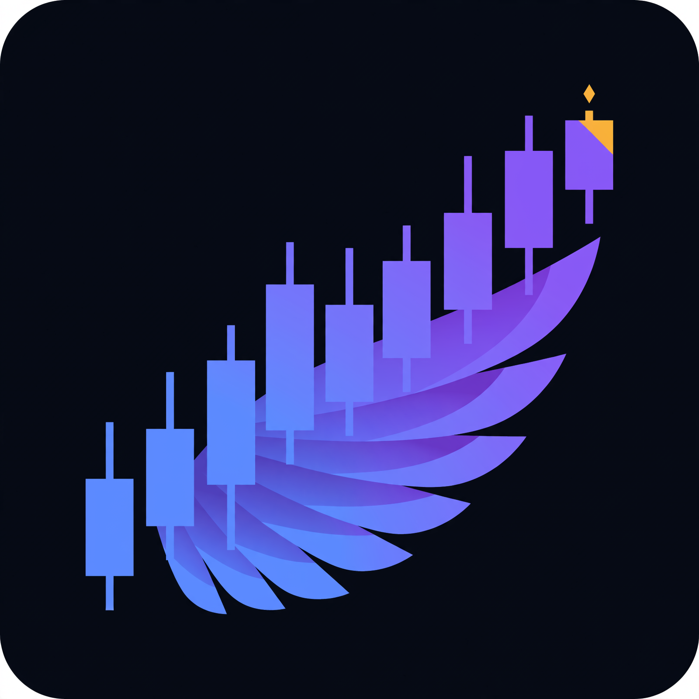

# MarketWingMan icon



The project icon: a wing whose layered feathers become ascending
candlesticks. It is the header image in the top-level `README.md` and
`submission.md`, the brand mark in the web app nav (`bot/theme.py`), and
the favicon served at `/icon.png` and `/favicon.ico` (`bot/muse_http.py`).

Generated with Muse Image (`muse-image-1.0`, `bot/models.py`) through the
project's journaled artist path (`bot/cards.py`). Brand palette from
`bot/theme.py`: dark navy `#070B14`, signal blue `#5B8CFF`, violet
`#8B5CF6`, spark amber `#F5B83D`. Prompt and hash are in `manifest.json`.
Regenerate with:

```bash
.venv/bin/python scripts/generate_icons.py
```
